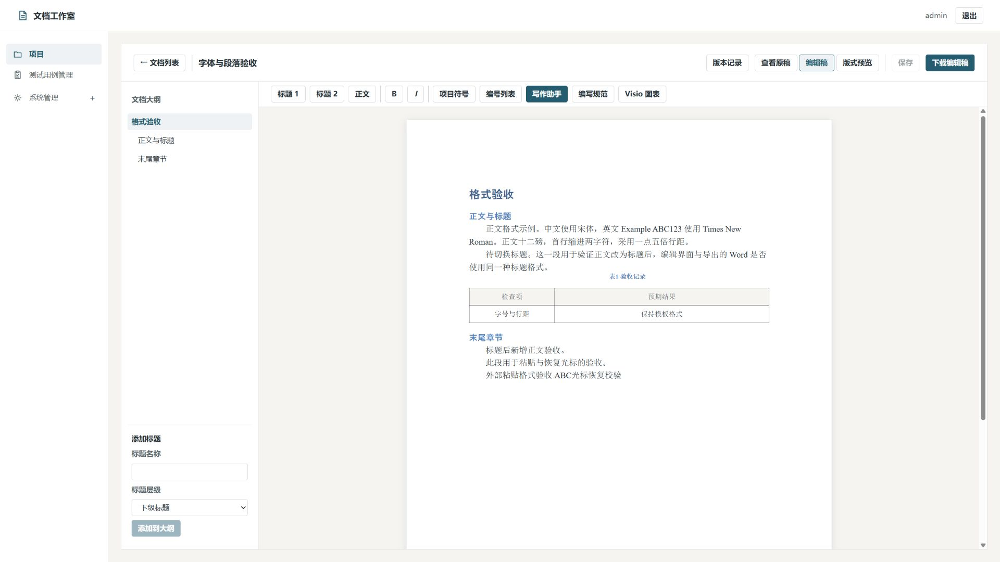
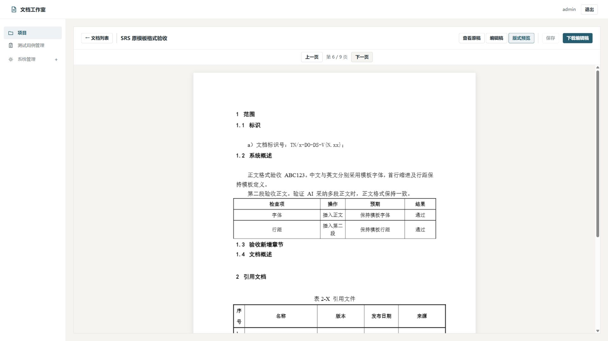

# Word 格式检查与修复

日期：2026-10-09。范围：模板生成、编辑正文、AI 草稿采纳、DOCX 下载、Word 版式预览。

## 查到的原因与修复

| 问题 | 原因 | 修复 |
| --- | --- | --- |
| 中文与英文字体混用 | 同一个 Word run 被整体分配一种字体 | 按原稿的中文、西文字体分别显示，保留文本与原有强调 |
| 标题字体与 Word 不同 | 忽略主题字体优先级和文档的东亚主题语言 | 按 Word 字体继承规则解析；直接设置的字体覆盖继承主题，同层主题优先于备用字体名 |
| 首行缩进、行距不一致 | 忽略按字符和行数设置的缩进、段距；相对单位没有使用实际字号 | 解析字符缩进、行数段距及最小行高，以实际文字字号计算 |
| 新增段落沿用标题、图表题注格式 | 附近段落的选择没有排除自定义大纲标题和题注 | 普通正文继承附近普通正文；新增标题继承同级原生标题样式 |
| 新增表格字体、列宽与边框丢失 | 只复制表格样式名，没有复制实际属性 | 继承同列数表格的网格、单元格、段落和文字属性；没有匹配表格时使用 Table Grid |
| 表格每一行字体不一致 | 从参考表格不同用途的行分别取格式 | 第一行取表头，后续行统一取数据行；不复制原内容或合并结构 |
| 跨页出现孤立表头 | 表头没有与首条数据绑定 | 对明确加粗的普通表头启用跨页重复，并与后续数据保持连接 |
| 新增章节没有进入下载稿目录 | 原目录字段缓存没有重新计算 | 导出临时副本时调用本机 Word 更新目录、图表目录与页码 |
| 粘贴、切换标题后出现外来字号 | 浏览器直接保留粘贴样式和自身标题样式 | 去掉外来样式，保存后重新应用原 Word 格式，恢复光标和滚动位置 |
| 编辑纸面与原稿不同 | 纸张与页边距写死 | 从原 Word 读取纸张和页边距；新增段落自动保存后重应用正文格式 |

格式规则参考 Microsoft 的 [RunFonts 文档](https://learn.microsoft.com/en-us/dotnet/api/documentformat.openxml.wordprocessing.runfonts?view=openxml-3.0.1) 与 [Word 目录更新接口](https://learn.microsoft.com/en-us/office/vba/api/word.tableofcontents.update)。实际行为同时与本机 Word 的导出结果核对。

## 实测记录

- 隔离数据库回归：106 项通过，覆盖原稿保留、样式继承、选择范围、AI 采纳接口、模板导入、图表和 SQLite 业务流程。一个现有依赖的 metadata 弃用警告不影响通过结果。
- 前端 `vue-tsc --noEmit` 和 `vite build` 通过。
- 浏览器使用 `http://localhost:5173`，1920×1080 截图并查看图片本身；实测标题转正文、带外部样式的粘贴、换段自动保存、光标恢复、下载按钮与 Word 上一页/下一页。
- 新建独立验收项目；SRS 文档通过真实 AI 草稿采纳接口写入两段正文与一张四列表格，并新增同级标题。此处验证采纳及格式链路，没有为这轮格式验收请求外部模型生成内容。
- 四份 DOCX 通过本机 Microsoft Word 生成分页 PDF，再用文档技能的 `render_docx.py` 渲染，并逐页查看：字体段落样例 1 页、SRS 模板 9 页、原有报告 12 页、原有测试结果 10 页，共 32 页。
- 原有两份业务文档的正文和版本号保持不变；原 SRS 模板 SHA256 保持不变。保留修复前数据库备份。独立验收项目已归档，可恢复回查。
- 无修改的底层 DOCX 仍按原文件复制；业务下载中存在目录时会在临时副本上重新计算目录，不改原稿。

### 固定桌面截图

## 已知边界与后续方向

1. 编辑区仍是连续正文编辑器。混合分节、分页、页眉页脚和复杂合并表格的完整排版以“版式预览”和实际导出的 Word 为准；连续编辑区中的合并表格仍会展开为 Markdown 网格，不能当作完整 Word 表格编辑器。
2. 原报告中的细长 Visio 图是原稿已有的整图缩放，本轮保留它；没有重新设计该图的内容、分段或横向纸张。
3. 完整分页预览、目录更新依赖本机安装 Microsoft Word；没有 Word 时给出明确错误。只更新文档目录和图表目录，不遍历更新全部外部字段。
4. 模板自身已有的字体差异、空白、手填占位符与遗留内容保留。样式约束来自具体模板，不统一硬改为某一种字体或行距。
5. 本轮更新当前源码及运行中的服务，没有重新构建以前的 EXE 部署包，也没有测试未提供的 Word 模板或其他 Office 排版引擎。

临时导出、Word 分页图、接口检查结果与后台日志在 `server/.qa-word-format-20261009/`，受 Git 忽略；不要把私有原稿、数据库或 AI 配置加入提交。
